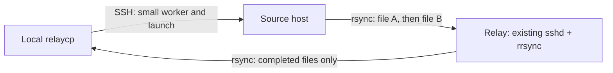

# RelayCopy

**`relaycp compute:/data/result.tar.gz ./` — copy through a relay without
installing a transfer client on the source yourself.**

[中文说明](README.zh-CN.md)

RelayCopy is a small orchestration layer over **OpenSSH, rsync and rrsync**.
It does not implement a new transfer protocol or run an application server.
File bytes travel from the source to your relay and then to the receiver.
The source SSH connection carries only the bootstrap and launch receipt.



Features:

- One-command remote-to-local copy using an existing SSH alias.
- Automatic content-addressed Python zipapp delivery; no source-side pip/curl.
- Optional delegation of a dedicated **write-only** upload key over SSH stdin.
- File-level pipeline: download completed A while the source uploads B.
- Resumable payloads, local job locks and source PID/start-time receipts.
- Final size and SHA256 checks before atomic, non-overwriting publication.
- JSON Lines output, reusable tickets, and a distributable Agent Skill.

## Requirements and installation

Linux source and receiver: Python >=3.10, OpenSSH client, rsync >=3.2.3.
Relay: existing OpenSSH sshd, rsync >=3.2.3 and rrsync. There is no new listener.
macOS/Windows/WSL interoperability is not yet tested; Linux is the supported v0.1
environment. The old rsync bundled with macOS is not sufficient.

Run from a checkout, without installing dependencies:

```sh
python3 scripts/build.py
./dist/relaycp.pyz --version
./dist/relaycp.pyz --config /path/to/config.json doctor
```

Or install the local project into your preferred virtual environment:

```sh
python3 -m pip install .
relaycp --version
```

There is no published PyPI release. `dist/relaycp.pyz` is the distributable
single-file CLI. Installation and packaging never modify SSH configuration.

## Configure once

First provision an isolated relay account/tree using [relay setup](server/README.md).
Give the receiver a read-only rsync key and each source a namespace-scoped
write-only key. Credentials are not part of this repository or the Skill.

Copy `config.example.json` to `~/.config/relaycopy/config.json` and edit it.
The example delegates the local `upload_key_file` to the source automatically,
pins `upload_known_hosts_file`, and uses the receiver's `relay-read` SSH alias.
The delegated private key is stored on the source in an owner-only directory,
mode 0600. It must **not** be your administrator or read key. Anyone controlling
the source can use that upload capability within its allowed namespace.

If a source already has a restricted upload key, omit `upload_key_file` and
`upload_known_hosts_file` and use remote paths instead:

```json
"upload": {
  "host": "relayuser@relay.example.org",
  "port": 2222,
  "key_file": "/data/relay/ssh/upload_key",
  "known_hosts": "/data/relay/ssh/known_hosts",
  "upload_root": "."
}
```

All paths inside `upload` are evaluated **on the source** for a remote copy.
`upload_key_file` and `upload_known_hosts_file` are evaluated on the local
controller. No broad default SSH key is selected for delegation.

For a relay read key restricted to `/srv/relaycopy/alice/incoming`, use
`download_root: "."`; tickets include the source namespace. An administrator
reusing an existing unrestricted SSH alias may instead specify an absolute
`download_root`. Shared users should receive restricted read credentials.

## Copy and resume

```sh
relaycp compute:/data/result.tar.gz ./
relaycp 'compute:/data/results with spaces.tar.gz' ./renamed.tar.gz
relaycp compute:/data/A.tar.gz compute:/data/B.tar.gz ./results/
```

The first JSON event prints a random job ID and ticket. The controller uploads a
small worker, starts it detached, and records its PID, `/proc` start ticks, bundle
SHA256 and log path. It does not leave the source-control SSH channel running.
The worker hashes an already-finished regular source file before upload.

For each file, the relay receives `manifest.json`, `payload`, and then
`complete.json`. The receiver waits for that file's completion receipt before
requesting its payload, then downloads it once using resumable rsync. In a batch,
it downloads completed A while the source uploads B. There is no same-file
streaming, custom chunk protocol or repeated polling of payload contents. Final
publication requires the completion receipt **and** SHA256 verification.

If interrupted, rerun the same copy with its recorded ID:

```sh
relaycp compute:/data/result.tar.gz ./ --id rc-THE_PREVIOUS_ID
```

This reuses an identified running worker or restarts it with the same input.
Keep the local state directory and source worker directory. Do not reuse an ID
for new content or clear the source state and then reuse an old ID. The source
may continue uploading after the local controller is interrupted.

To hand a task to another agent or receive on another machine:

```sh
relaycp status relay://compute/rc-THE_PREVIOUS_ID
relaycp receive relay://compute/rc-THE_PREVIOUS_ID ./
```

A ticket locates data; it grants no permissions. A receiver must have its own
authorized read credential. `status: incomplete` means no completion receipt was
found; it is not evidence that a worker is still running. Inspect the recorded
source log/state if a sender fails. Receiver authentication errors fail immediately;
missing upload receipts are followed up to `--wait-seconds` (default 3600).

For an explicit upload from the current machine, configure `profiles.default.upload`
and `namespace`, then use `relaycp send FILE [FILE ...]`. Another machine can receive its
ticket. Source files and relay copies are never automatically deleted.

## Compatibility and limits

- This CLI accepts a useful **scp-style syntax subset**: regular files from one remote host
  to a local directory, or one file to a local filename. It is not the SCP/SFTP wire protocol or a drop-in replacement
  for every scp flag. Native `scp` cannot use a forced-rsync key.
- v0.1 does not implement recursive copies, globs, local-to-remote one-command
  copies, remote-to-remote copies, a daemon, automatic cleanup, or quota management.
- The source must remain unchanged. Symlinks and devices are rejected.
- Both network legs can overlap but share bandwidth and relay disk I/O. No
  guaranteed speedup is claimed. `--bwlimit` caps source upload in KiB/s.
- The relay retains the **whole files** in a batch. It needs space for the batch
  and does not provide a bounded streaming cache. Single-file download starts
  only after upload completes; file-level overlap needs at least two files.
- The first release uses random job IDs plus local locks, not a distributed lock
  service. Use one owner per upload namespace; protect the relay storage from
  unrelated writers and never reuse IDs for different data.
- SHA256 detects transfer corruption against the sender's manifest; it does not
  establish that an authorized sender supplied trustworthy content.

## Agent Skill

Distribute `skills/relaycopy/` with the CLI. For Codex, copy it into the consuming
project's `.agents/skills/`. Other harnesses can use their supported skill location
or explicitly read `SKILL.md` before invoking the same CLI. CLI versions are
pinned by the distributed artifact; no agent-specific SDK is needed.

## Development

```sh
python3 -m unittest tests.test_unit -v
RELAYCP_INTEGRATION=1 python3 -m unittest tests.test_integration -v
python3 scripts/build.py
```

Integration tests start their own sshd on a random loopback port and use generated
ephemeral keys, real rsync, and real forced-command rrsync. They never contact an
external server. See [CONTRIBUTING.md](CONTRIBUTING.md) and [SECURITY.md](SECURITY.md).

## License and upstream tools

RelayCopy's original code is MIT licensed. OpenSSH, rsync and rrsync are invoked as
external programs and retain their own licenses; their source/binaries are not
vendored. The orchestration relies on the official [rsync append-verify behavior](https://download.samba.org/pub/rsync/rsync.1)
and [rrsync restrictions](https://download.samba.org/pub/rsync/rrsync.1).
